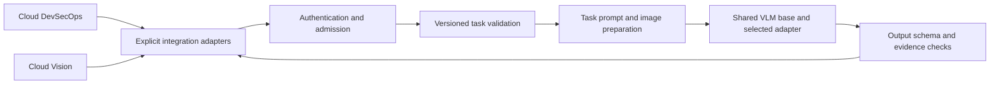

# Valar LLM architecture

Status: Phase 0 implementation, 11 November 2026. Model quality and remote runtime compatibility are unmeasured.

Valar adapts one provisional multimodal base for three product roles. The application owns retrieval and orchestration; the model interprets bounded evidence. Compact incident extraction is a submode of the researcher, not a fourth product role.

The initial implementation is a modular Python package, with one cloud smoke service. It avoids requiring separate databases, queues, containers or network services before serving feasibility is established. The package boundaries are designed to allow those components later when measurements justify them.

| Module | Owns | Must not own |
| --- | --- | --- |
| `contracts` | Strict request envelopes, upstream response schemas, ID/quote/prerequisite consistency | Search, inference, semantic truth judgments |
| `integrations` | Pure conversion of already-selected application inputs | Imports from either app, mutation of upstream code |
| `runtime` | Model/processor revision, prompt rendering, image slots, inference | Retrieval, paid fallback, dataset selection |
| `data` | Synthetic fixture loading/rendering | Human-gold claims or bulk collection in Phase 0 |
| `train` | Bounded online QLoRA smoke, answer masking, adapter save | Full fine-tuning or automatic publication |
| `eval` | Offline checks and real inference measurement files | Training selection on test data |
| `gateway` | Authentication and atomic admission reservations | Product authentication/user isolation in Phase 0 |
| `serve` | Gradio/ZeroGPU smoke entry point and bounded dispatch | Production availability guarantees |

## Contract lifecycle

Requests carry a literal task ID and `contract_version: "1"`. The researcher uses either `researcher.compact` with native `k/m/p`, or `researcher` with the native full incident schema. Reviewer outputs preserve findings, assessments, defenses and rejected matches. Vision preserves `status`, claims and supplied citations.

Canonical output schemas are packaged under `src/valar_llm/contracts/schemas/`. Top-level `schemas/` is a generated export, checked for drift in tests. Snapshot provenance records the inspected upstream file hash. Input envelopes deliberately bound Phase 0 context; they are not claims of complete application integration. `docs/application-contracts.md` records remaining parity work.

Schema validity, source-quote matching, known evidence IDs and consistent prerequisite states can be checked by code. Whether a quote supports an assertion still requires evaluation and human review. Untrusted instructions remain in evidence, never the system prompt.

Vision evidence metadata and page images are ordered one-to-one. The serving interface takes uploaded files separately from JSON; it never fetches image URLs or accepts arbitrary local paths from request JSON. Immutable version IDs and page numbers remain in metadata. The application must resolve those references to the correct bytes; the model cannot independently verify the storage mapping.

## Experiment lifecycle

1. Validate synthetic requests and target shapes offline.
2. Load an immutable base/processor revision in a free online CUDA notebook.
3. Measure base inference including an image-only factual question.
4. Train three steps on one synthetic image fixture with exact prompt-prefix masking.
5. Save adapter, processor, masking audit, settings, source hashes and actual measurements.
6. Persist outside the notebook VM; restart, restore and run inference in a fresh process.
7. Package a ZeroGPU Space, verify free account eligibility, and measure remote requests.
8. Only after this gate: pilot data, baselines and task-by-task training.

Separate role adapters are the starting design. Phase 0 creates one disposable smoke adapter to test mechanics; it is not a trained three-role release. A balanced shared adapter is a later measured comparison.

## Availability and cost boundaries

The service defaults to disabled, accepts only allowlisted tasks, limits file/request/token size, runs one request concurrently, queues at most two requests, reserves a small global daily request count, and never calls a paid fallback. Failure paths return explicit status objects. Provider daily GPU quotas remain independent of the request cap.

The SQLite cap survives process restarts only while its file persists. Free Space storage can be ephemeral: this is not a distributed durable budget or a production abuse-prevention system. There is no metered backend in this smoke implementation. Per-user product limits, durable shared budgets, cancellation, deployment monitoring, user isolation and application cloud hosting remain Phase 5 work.

The Gradio queue is outside the callback; unauthorized requests can occupy CPU queue slots but cannot allocate a GPU through this code. Uploaded temporary files follow Gradio hosting retention; this smoke accepts synthetic inputs only. Do not connect private documents until retention and platform logging are verified.

CPU initialization before allocation, followed by GPU placement inside the decorated call, is an explicit ZeroGPU compatibility hypothesis. First model download, CPU memory, adapter restoration, transfer time, and the GPU decorator duration need measurement. Responses identify the adapter manifest hash so a base-only endpoint cannot silently pass an adapter probe. If the host cannot run the candidate within free constraints, change the candidate/route before dataset expansion.
